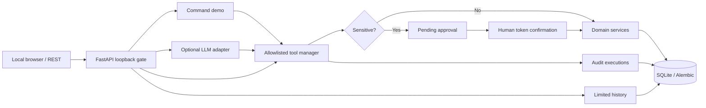

# Architecture and engineering decisions

## ADR-001: Keep execution separate from interpretation

The AI adapter emits only a name and JSON arguments from a constrained registry. Pydantic revalidates every call. Each handler invokes a fixed business service, not an arbitrary HTTP URL, filesystem path or shell command. Demo inputs follow a fixed grammar and use the *same* handlers. No multi-agent framework.

## ADR-002: Sensitive changes are an authorization boundary

Edits/deletes become pending proposals. One-time random tokens are hashed at rest; approvals expire and are consumed using a conditional database update. The claim is committed **before** applying a sensitive operation. Approve/reject are dedicated HTTP UI actions, absent from the model tool catalog. Repeated requests fail even if an earlier operation failed. Local-only HTTP is the first boundary, not a production authentication scheme.

## ADR-003: Keep time coherent

Inputs require ISO-8601 offsets. Events require an IANA zone with matching offsets to reject contradicting or non-existent local times. All persisted instants use UTC ISO strings. Daily summaries calculate calendar-day UTC boundaries using the selected IANA zone, including DST changes. UTC is the documented default, not a user-inferred timezone.

## ADR-004: Local storage and limited retention

SQLite is intentionally adequate for a single-user development demo. No multi-user tenant model or externally delivered alerts. Conversation history is pruned on chat writes using `PA_HISTORY_RETENTION_DAYS`, 30 by default. Tool logs contain outcomes rather than raw input; pending approval arguments are stored locally and should be treated as private. Operators are responsible for local file access and backups.

## ADR-005: Reproducible evaluation

Synthetic commands execute against fresh databases with no LLM API. CI runs Python 3.14, unit/API tests, migration roundtrips, 24 synthetic scenarios and package build. Real provider evaluations are separate, require an explicit account and may cost money. No claims are made for unexecuted evaluations.

## Threat model and limitations

- **Prompt injection:** input and model output never change the registry, risk map or authorization checks.
- **SSRF / RCE:** no user-directed URLs, arbitrary filesystem operations, shell or Python evaluation tools. Operator-configured provider URL is independent of model input.
- **Remote exposure:** server binds loopback and rejects non-loopback socket peers; there is no auth for a public deployment.
- **Secrets:** environment variables only, no checked-in real keys. Do not log provider responses or request bodies in production.
- **Resource use:** 2,000-char chat input, bounded model responses, tool call budget and HTTP timeout. Provider rate/billing caps must be configured at the provider.
- **Authorization:** local browser confirmation is meaningful only for a trusted single local user, not an internet-facing system.
- **Reminders:** polling and explicit mark-delivered are supported, but there are no operating-system notifications or background delivery guarantees.
- **History:** retention cleanup happens on chat writes; inactive databases need operator-managed purge if required.
- **No automatic deployment, review request, merge or paid API invocation in CI.**

## Security review follow-ups (Codex)

- **DNS rebinding / CSRF:** The HTTP middleware enforces the local socket peer, exact allowlisted Host values, same-origin Origin/Referer/Fetch Metadata, and `X-Local-Request: 1` for mutations. The browser UI and documented curl mutations supply the required header. This is a defense for a local single-user demo, not production authentication.
- **Approval identity:** Tasks/events have immutable random `resource_identity` UUIDs with unique indexes. Proposals retain the target identity and verify it again before execution. Existing databases receive backfilled UUIDs. Pending approvals created before the upgrade are rejected, never executed.
- **Linked reminders:** An approved task/event deletion transactionally **unlinks** reminders from the deleted parent and preserves their messages, dates, and any other parent link. The response includes `detached_reminders`.
